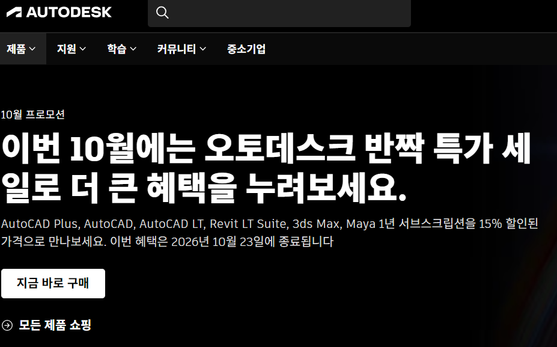

# 01. Fusion 설치와 교육용 라이선스

## 학습 목표
- 교육용 플랜으로 Autodesk 학생 인증을 마칠 수 있습니다. 작업중
- Autodesk Fusion을 내려받아 설치할 수 있습니다.
- 3D 모델링 개발 환경을 구성할 수 있습니다. 

## 학습내용

### (1) Autodesk Fusion이란
Fusion 360은 지금 **Autodesk Fusion**으로 이름이 바뀌었습니다.
Autodesk Fusion은 3D 모델을 설계하는 프로그램입니다. 스케치를 그려 입체로 만들고, 부품을 조립해 움직임을 확인하고, 도면을 만들고, 3D 프린터로 출력할 파일을 내보낼 수 있습니다. 작업 순서가 타임라인에 기록되어, 앞 단계의 치수를 고치면 뒤 단계의 결과도 함께 바뀝니다.

이 교재에서는 Fusion으로 부품을 설계하고 Bambu Lab P1S 프린터로 출력하는 과정까지 다룹니다.

### (2) 교육용 플랜을 받습니다
체험판이나 개인용이 아니라 **교육용 플랜**을 받습니다.
교육용 플랜은 기능 제한이 없고 1년 동안 무료로 쓸 수 있습니다.

### (3) 학생 인증하기
1. [autodesk.com/eligibility](https://www.autodesk.com/eligibility)에 접속합니다.
2. **학생**을 선택합니다.
3. 학생 인증을 진행합니다.
4. 학생인증 서류는 행정실에서 '재학증명서'를 발급받아 제출합니다.
5. 교육용 약관에 동의합니다.

**계정 정보 기록:** 계정을 새로 만들었다면 이메일과 비밀번호를 꼭 따로 적어 두세요.
나중에도 같은 계정으로 로그인해야 합니다.

**자동 인증이 안 될 때:** 재학증명서를 업로드합니다. 인증은 **14일 안에** 완료해야 합니다.

### (4) Fusion 내려받기와 설치
인증을 마친 뒤 Fusion을 내려받아 설치합니다.
설치 파일은 누구나 같고, 내 계정에 교육용 권한이 붙는 방식입니다.

### (5) 라이선스 확인과 재인증
- 계정 메뉴에서 라이선스 유형이 **교육용**인지 확인합니다.
- 교육용 라이선스는 매년 다시 인증해야 합니다. 만료 전에 안내 메일이 옵니다.

## 영상
<!-- TODO: 유튜브 영상 ID -->
<iframe width="100%" height="420" src="https://www.youtube.com/embed/영상ID"
  allowfullscreen></iframe>
